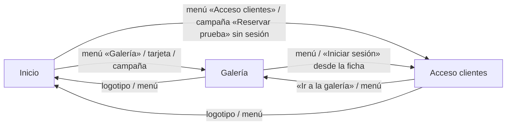

# Documentación técnica — Práctica 1: Prototipo Polestar Store (WPF / Blend)

**Asignatura:** Interfaces de Usuario · Grado en Ingeniería Informática en Tecnologías de la Información (UMH)
**Autor:** Pablo Lizón Garay
**Fecha de entrega:** 12 de noviembre de 2026

---

## Índice
1. Interpretación de los requisitos y objetivos
2. Arquitectura y estructura de la aplicación
3. Flujo de navegación y función de cada pantalla
4. Justificación de las decisiones de diseño
5. Animaciones
6. Pruebas, problemas encontrados y mejoras
7. Fuentes, recursos y licencias
8. Enlaces públicos
9. Uso de inteligencia artificial

---

## 1. Interpretación de los requisitos y objetivos

El cliente (Polestar) quiere un prototipo de aplicación de escritorio para **tiendas que venden sus coches**:
la usarán el personal y los clientes en el punto de venta. De ahí salen dos ideas que guían el diseño:
el lenguaje es cercano al cliente final y la información debe poder enseñarse en tienda (precios claros,
estimación de cuota, solicitud de prueba de conducción).

| Requisito del enunciado | Cómo se resuelve en el prototipo |
|---|---|
| Pantalla de inicio con productos novedosos, mejor precio, ofertas estacionales y campañas | `InicioWindow`: carrusel de 3 campañas y pestañas *Novedades*, *Mejores precios* y *Ofertas de temporada*. |
| Elementos adicionales que aporten funcionalidad (opcional) | Calculadora de cuota mensual orientativa y bloque informativo «100 % eléctricos» con GIF. |
| Pantalla de logueo con texto tipo contraseña y gestión de errores | `LoginWindow`: `PasswordBox` (oculta los caracteres), mensajes para campos vacíos, credenciales incorrectas y acceso correcto, aviso de Bloq Mayús. |
| Galería con todos los productos | `GaleriaWindow`: los 8 modelos del catálogo, con búsqueda, filtros, orden y ficha de detalle. |
| Menú navegacional y logotipo comunes a todas las pantallas | Control de usuario `Controls/Cabecera` incluido en las tres ventanas. |
| Componentes comunes añadidos, justificados | Indicador de sesión (en la cabecera) y pie de página (`Controls/Pie`). Justificación en el apartado 4.6. |
| Animaciones obligatorias, sin abusar | Animaciones de 150–300 ms ligadas a acciones del usuario; GIF limitado a 3 repeticiones. Ver apartado 5. |
| Realizarlo en Microsoft Blend con un proyecto WPF | Proyecto WPF (.NET 10) abierto y editable en Blend for Visual Studio. |
| Conducción autónoma «no madura» en Europa (contexto del cliente) | La ficha de cada modelo avisa de que la conducción autónoma completa aún no se vende en Europa, para no generar expectativas falsas. |

**Decisiones de interpretación**
- Los datos son **orientativos y ficticios**, porque es un prototipo: precios redondos, datos aproximados...
  y sin especificaciones técnicas. Las fotos sí son reales, para que el prototipo se entienda mejor.
- La autenticación es **simulada** con una única cuenta de prueba (`Alumno` / `1234`), siguiendo el esquema
  «Controlar Login» de la asignatura.
- Cada sección es una **ventana WPF independiente**, tal como se explicó en clase (`Window x = new ...(); x.Show();`).
- **Ninguna pantalla usa barra de desplazamiento**: todo debe verse de un vistazo en el tamaño de la ventana
  (por eso Inicio usa pestañas y la Galería una cuadrícula fija de 4 × 2).

---

## 2. Arquitectura y estructura de la aplicación

```
PolestarApp/
├─ App.xaml / App.xaml.cs   Recursos globales: paleta, tipografía, estilos de botones y campos,
│                           plantilla de tarjeta de coche. Arranca en InicioWindow (StartupUri).
├─ InicioWindow.xaml(.cs)   Pantalla de inicio
├─ LoginWindow.xaml(.cs)    Acceso de clientes
├─ GaleriaWindow.xaml(.cs)  Galería y ficha de detalle
├─ Controls/
│   ├─ Cabecera             Logotipo + menú + indicador de sesión (común)
│   └─ Pie                  Aviso de prototipo y ayuda (común)
├─ Models/
│   ├─ Coche.cs             Producto: datos y textos ya formateados para la vista
│   └─ Campana.cs           Campaña del carrusel y su destino
├─ Services/
│   ├─ Catalogo.cs          Datos ficticios y consultas (novedades, precios, ofertas)
│   ├─ Sesion.cs            Sesión simulada + evento Cambiada
│   ├─ Navegacion.cs        Cambio de ventana conservando posición y tamaño
│   └─ Animaciones.cs       Animaciones de entrada; respetan la configuración de Windows
└─ Images/carga.gif         GIF de batería cargándose
```

**Separación de responsabilidades.** Las ventanas (XAML + code-behind) solo se ocupan de la presentación y
de responder a eventos. Los datos están en `Models` y `Services`, de modo que en una versión real
`Catalogo` podría sustituirse por una API sin tocar las pantallas.

**Reutilización.** El aspecto se define una sola vez en `App.xaml` (colores como recursos `Br*`, estilos
`Txt*`, `Btn*`, `Campo*`) y la tarjeta de producto es una única `DataTemplate` (`PlantillaTarjetaCoche`)
usada en Inicio y en Galería. Cambiar un color o la tarjeta se hace en un solo sitio.

**Paquetes externos.** `WpfAnimatedGif` (NuGet) para reproducir el GIF con un número limitado de repeticiones.

---

## 3. Flujo de navegación y función de cada pantalla



- El **menú** y el **logotipo** están en todas las ventanas, así que desde cualquier pantalla se llega a las
  otras dos en un clic. El logotipo lleva siempre a Inicio (convención web/escritorio).
- Al cambiar de sección, `Navegacion.MismaPosicion` coloca la nueva ventana en el mismo sitio y con el mismo
  tamaño (también si estaba maximizada) antes de cerrar la anterior: el usuario percibe un cambio de
  sección, no una ventana nueva que salta.
- Algunos accesos llevan a un estado concreto: la campaña de invierno abre la Galería filtrada por ofertas;
  una tarjeta de Inicio abre la Galería con la ficha de ese modelo.

**Ninguna ventana tiene barra de desplazamiento.** Todo el contenido cabe en el tamaño por defecto
(1280 × 780) y en el mínimo permitido (1200 × 740). Las zonas que se adaptan son las tarjetas: no tienen
tamaño fijo y se reparten el espacio de su cuadrícula. Comprobado al ejecutar la aplicación el 9 y el 12 de noviembre
de 2026 ([16](capturas/16-sin-scroll-inicio.jpg), [18](capturas/18-sin-scroll-galeria.jpg),
[19](capturas/19-ficha-compacta.jpg), [21](capturas/21-login-centrado.jpg)).

### Inicio
Dos columnas. A la izquierda, el carrusel de campañas (avanza cada 8 s, se pausa con el ratón o el foco,
flechas y puntos para controlarlo) y debajo una fila de 4 tarjetas con tres pestañas: *Novedades*,
*Mejores precios* y *Ofertas de temporada* (Alt+N, Alt+P, Alt+T). Las pestañas permiten mostrar las tres
listas del enunciado sin alargar la página. A la derecha, el bloque «100 % eléctricos» con el GIF y la
calculadora de cuota (modelo, % de entrada y plazo → cuota estimada con un TIN ficticio del 5,99 %).

### Acceso clientes
Formulario de usuario y contraseña. Flujo de validación (esquema de la asignatura):
1. Campo vacío → aviso (icono de advertencia) y foco en el primer campo que falta.
2. Credenciales incorrectas → error (icono de error), se vacía la contraseña y se deja el foco en ella.
3. Correctas → confirmación, se inicia la sesión y se muestra la vista «Hola, Alumno» con acceso directo a la galería.

### Galería
Los 8 modelos en una cuadrícula fija de 4 × 2, con búsqueda (ignora mayúsculas y tildes), filtro por tipo,
«solo ofertas», cuatro criterios de orden, contador de resultados y estado vacío con botón «Limpiar filtros».
Cada tarjeta muestra una foto real del modelo. Al pulsarla se abre a la derecha una ficha compacta con la foto,
el precio orientativo, la autonomía aproximada, una frase de descripción, el aviso sobre conducción autónoma y
botón «Solicitar prueba de conducción». La respuesta sale en un cuadro de mensaje: sin sesión pregunta
«¿Quieres iniciar sesión ahora?» (Sí lleva a Acceso clientes); con sesión confirma la solicitud simulada.

---

## 4. Justificación de las decisiones de diseño

### 4.1 Consistencia y estándares
- Cabecera, pie, tipografía, colores y tarjetas idénticos en las tres pantallas (componentes y estilos compartidos).
- Convenciones de Windows: teclas de acceso con Alt (subrayadas), Intro envía el formulario (`IsDefault`),
  Esc cierra la ficha, cuadros de mensaje estándar con icono según gravedad, iconos de la fuente del sistema.
- El logotipo vuelve a Inicio y la sección activa aparece marcada en el menú (subrayado), como en la mayoría de aplicaciones.

### 4.2 Jerarquía visual
- Escala tipográfica fija: H1 28 px, H2 20 px, H3 16 px, cuerpo 14 px, secundario 13 px.
- Un único color de acento (dorado) para la sección activa y la insignia «Oferta»; el resto en neutros
  (inspiración escandinava, coherente con la marca).
- En las tarjetas, lo más destacado es el precio final; el precio original aparece tachado y más pequeño.

### 4.3 Prevención y gestión de errores
- `PasswordBox` para que la contraseña no se vea en pantalla.
- Aviso de Bloq Mayús activado mientras se escribe la contraseña.
- Mensajes de error claros, sin culpar al usuario, y el foco vuelve donde hay que corregir.
- Búsqueda tolerante (mayúsculas/tildes) y estado vacío que explica qué pasa y cómo salir.
- La solicitud de prueba sin sesión no falla en silencio: un cuadro de mensaje explica por qué y ofrece ir a
  iniciar sesión.

### 4.4 Feedback
- Hover y pulsación en todos los botones; las tarjetas se elevan ligeramente al pasar el ratón.
- Indicador de sesión siempre visible en la cabecera («Invitado» / «Hola, Alumno»).
- Contador «N modelos de 8» al filtrar; cuadro de mensaje de confirmación al solicitar una prueba.
- Sin barra de desplazamiento, todo lo importante (y la respuesta a cada acción) queda siempre a la vista.

### 4.5 Accesibilidad
- Contraste de texto comprobado frente a blanco (WCAG AA): texto principal ≈ 18,9:1, secundario ≈ 7:1.
- Toda la aplicación es usable con teclado. Botones, pestañas y campos de texto muestran un indicador de foco
  propio (borde azul de 2 px); los desplegables y el control deslizante usan el foco punteado de Windows,
  menos visible (prueba 12, ver 6.2).
- Nombres accesibles (`AutomationProperties.Name`) en botones de icono y tarjetas para lectores de pantalla.
- Zonas de clic mínimas (los puntos del carrusel miden 8 px pero responden en 20×20 px).
- Las animaciones lanzadas desde código (entrada de cada ventana, cambio de campaña y de pestaña, apertura de
  la ficha) se desactivan si el usuario ha quitado los efectos de animación en Windows (Accesibilidad > Efectos
  visuales). El subrayado del menú y la elevación de las tarjetas, definidos en estilos XAML, el avance
  automático del carrusel y el GIF no comprueban esa preferencia (prueba 13, ver 6.2).
- El carrusel automático se puede pausar y controlar (criterio WCAG 2.2.2 «Poner en pausa, detener, ocultar»).

### 4.6 Componentes comunes añadidos
- **Indicador de sesión:** el usuario sabe en todo momento si está identificado, algo necesario porque
  la solicitud de prueba depende de ello (visibilidad del estado del sistema).
- **Pie:** deja claro en todas las pantallas que precios y datos son orientativos (evita confusiones en tienda),
  cita el origen de las fotos (Wikimedia Commons) y recuerda que hay un asesor disponible (ayuda).

### 4.7 Diseño centrado en el usuario
El diseño está centrado principalmente en el cliente en tienda. He priorizado la claridad y la accesibilidad para garantizar
las mínimas confusiones posibles y favorecer la comprensión de posibles clientes de Polestar. He enseñado el prototipo a familiares
para comprobar si la interfaz es intuitiva, y por último he hecho una auditoría de diseño usando el modelo Opus 5.5 de Claude para
comprobar que la interfaz es clara y concisa.

### 4.8 Logotipo
Me he limitado a usar el logotipo tipográfico de Polestar store para favorecer el entendimiento.

---

## 5. Animaciones

| Animación | Dónde | Duración | Motivo |
|---|---|---|---|
| Subrayado de la sección activa | Menú | 150 ms | Indica dónde está el usuario |
| Elevación + sombra de la tarjeta | Tarjetas de coche | 150 ms | Indica que es clicable |
| Aparición del contenido | Al abrir cada ventana | 220 ms | Suaviza el cambio de sección |
| Cambio de campaña | Carrusel | 300 ms | Señala que el contenido ha cambiado |
| Apertura de la ficha | Galería (Storyboard `SbAbrirDetalle`, editable en Blend) | 200 ms | Relaciona la ficha con la tarjeta pulsada |
| Cambio de pestaña | Inicio, tarjetas de productos | 200 ms | Señala que la lista ha cambiado |
| GIF de batería | Inicio | 3 repeticiones | Refuerza «100 % eléctricos» y se detiene en el último fotograma |

Criterio de «uso y no abuso»: todas son cortas, la mayoría responden a una acción del usuario, ninguna
bloquea la interacción y no hay movimiento continuo: el carrusel se pausa con el ratón o el foco y el GIF se
detiene tras 3 repeticiones. La preferencia del sistema de quitar animaciones se respeta solo en parte
(ver 4.5 y la prueba 13).

---

## 6. Pruebas, problemas encontrados y mejoras

### 6.1 Pruebas realizadas
Pruebas realizadas por primera vez el 4 de noviembre de 2026, repetidas el 9 de noviembre con el diseño sin
barra de desplazamiento y **de nuevo el 12 de noviembre de 2026 con las fotos reales de los modelos**, en
Windows 11 con la aplicación recompilada en Blend for Visual Studio 2026 (0 errores). Los resultados y todas las
capturas corresponden a esta última versión. Las capturas están en [`capturas/`](capturas/).

| # | Prueba | Resultado esperado | Resultado obtenido |
|---|---|---|---|
| 1 | Pulsar «Entrar» con los dos campos vacíos | Aviso de campos vacíos, foco en Usuario | Correcto. Aviso «Inserte el nombre del usuario o el Password» con icono de advertencia; al aceptar, el foco queda en Usuario. [01](capturas/01-login-campos-vacios.jpg) |
| 2 | Usuario escrito y contraseña vacía | Aviso, foco en Contraseña | Correcto. Mismo aviso; al aceptar, el foco pasa a Contraseña. [02](capturas/02-login-foco-en-contrasena.jpg) |
| 3 | Credenciales incorrectas | Error, contraseña vaciada, foco en Contraseña | Correcto. Error «El nombre de usuario o el password es incorrecto» con icono de error; al aceptar, la contraseña queda vacía y con el foco, y el usuario se conserva. [03](capturas/03-login-credenciales-incorrectas.jpg) |
| 4 | `Alumno` / `1234` | «Usuario correcto», cabecera muestra «Hola, Alumno» | Correcto. «Usuario correcto» con icono de información; se muestra «Hola, Alumno», la cabecera indica la sesión con «Cerrar sesión» y el menú pasa a «Mi cuenta». [04a](capturas/04a-login-usuario-correcto.jpg) · [04b](capturas/04b-login-sesion-iniciada.jpg) |
| 5 | Escribir la contraseña con Bloq Mayús | Aparece el aviso | Correcto. |
| 6 | Navegar entre las 3 secciones con el menú y el logotipo | La ventana cambia sin moverse de sitio | Correcto. Inicio → Galería → Acceso clientes → logotipo: cada ventana se abre en la misma posición y tamaño, la anterior se cierra y el subrayado marca la sección activa. Ninguna ventana muestra barra de desplazamiento. [00](capturas/00-inicio-gif.jpg) · [06](capturas/06-navegacion-misma-posicion.jpg) |
| 7 | Navegar con la ventana maximizada | La nueva ventana también se abre maximizada | Correcto. Con Inicio maximizada, Galería se abre también maximizada y las 8 tarjetas ocupan todo el ancho. [07](capturas/07-navegacion-maximizada.jpg) |
| 8 | Buscar «coupe» en Galería | Aparecen los Polestar 4 (SUV coupé) | Correcto. «coupe» muestra «2 modelos de 8»: los dos Polestar 4 (SUV coupé). [08](capturas/08-busqueda-coupe.jpg) |
| 9 | Buscar un texto sin resultados | Estado vacío con «Limpiar filtros» | Correcto. «xyz» muestra «Ningún modelo de 8» y el estado vacío; su botón «Limpiar filtros» recupera los 8 modelos y devuelve el foco a Buscar. [09](capturas/09-estado-vacio.jpg) |
| 10 | Solicitar prueba sin sesión / con sesión | Ofrece iniciar sesión / confirma la solicitud | Correcto. Sin sesión, un cuadro de mensaje explica que hace falta iniciar sesión y pregunta «¿Quieres iniciar sesión ahora?» (Sí abre Acceso clientes, No vuelve a la ficha). Con sesión, otro cuadro confirma «Solicitud enviada (simulada) para el Polestar 4…». La respuesta siempre queda a la vista. [10a](capturas/10a-prueba-sin-sesion.jpg) · [10b](capturas/10b-prueba-con-sesion.jpg) |
| 11 | Esc con la ficha abierta | Se cierra la ficha | Correcto. Esc cierra la ficha y el foco vuelve a la tarjeta desde la que se abrió. [11](capturas/11-esc-cierra-ficha.jpg) |
| 12 | Usar toda la app solo con teclado (Tab, Alt+letra, Intro, Esc) | Todo es alcanzable y el foco se ve | Correcto en lo probado: Alt+I, Alt+G y Alt+A (Alt+U con sesión iniciada), Tab y Mayús+Tab por cabecera y controles con recuadro de foco azul, Intro (login y avisos), Esc (ficha) y flechas (calculadora). Detalle: los desplegables y el control deslizante muestran el foco punteado de Windows, menos visible. [12](capturas/12-teclado-foco-visible.jpg) |
| 13 | Desactivar animaciones en Windows y abrir la app | No hay animaciones, todo se muestra igual | Parcial. Sin «Efectos de animación», la ficha aparece ya completa justo después del clic (sin transición), igual que la entrada de cada ventana. Siguen activos el subrayado del menú y la elevación de las tarjetas (Storyboards en estilos XAML), el avance automático del carrusel y el GIF. [13](capturas/13-sin-animaciones-ficha.jpg) |
| 14 | Calculadora: cambiar modelo, entrada y plazo | La cuota se recalcula al momento | Correcto. La cuota se recalcula con cada cambio: Polestar 2 Standard range, 20 %, 48 meses → 843 €; Polestar 2 Long range Dual motor, 25 %, 60 meses → 810 €. Ambas coinciden con el cálculo manual al 5,99 %. [14](capturas/14-calculadora.jpg) |
| 15 | Abrir el proyecto en Blend y editar `SbAbrirDetalle` | El Storyboard se puede ver y modificar | Correcto. GaleriaWindow.xaml (nuevo diseño) carga en Blend sin problemas; en «Objetos y escala de tiempo» se abre SbAbrirDetalle en modo grabación y se ve el fotograma clave de PanelDetalle. No se guardaron cambios. [15](capturas/15-blend-sbabrirdetalle.jpg) |

### 6.2 Problemas encontrados y mejoras aplicadas
Detectados en la revisión de código asistida por IA del 4 de noviembre de 2026:
- Tras un error de credenciales el foco volvía siempre a Usuario y la contraseña se mantenía →
  ahora se vacía la contraseña y el foco va al campo que hay que corregir.
- Los cuadros de mensaje no tenían título ni icono → se añadieron (advertencia, error, información).
- Quedaban estilos sin usar de una versión anterior del login (`TxtErrorCampo`, `Tag="Error"`, `BrError`) → eliminados.
- **Mensajes de la ficha fuera de la vista** (prueba 10) → la respuesta a «Solicitar prueba» se muestra en un
  cuadro de mensaje, como en el login.
- Tamaño mínimo de las ventanas: 1200 × 740 (antes 1000 × 620), para garantizar que todo cabe.

Detectados al ejecutar las pruebas (4 de noviembre de 2026, confirmados al repetirlas el 9):
- **Foco poco visible** (prueba 12) en desplegables y control deslizante, que usan el estilo de foco por defecto.
- **Pantallas pequeñas o con escala alta** (limitación conocida): sin barra de desplazamiento, el tamaño mínimo
  de 1200 × 740 px no cabe en pantallas de 1366 × 768 ni en 1920 × 1080 con escala del 150 %, y la parte
  inferior quedaría cortada.

---

## 7. Fuentes, recursos y licencias

| Recurso | Uso | Procedencia | Licencia / condiciones |
|---|---|---|---|
| WPF / .NET 10 | Plataforma de la aplicación | Microsoft | MIT |
| Blend for Visual Studio | Diseño y edición del XAML | Microsoft (incluido en Visual Studio) | Licencia de Visual Studio |
| WpfAnimatedGif 2.0.2 | Reproducir el GIF con 3 repeticiones | NuGet (proyecto de Thomas Levesque) | Apache 2.0 |
| Segoe UI | Tipografía | Fuente del sistema Windows | Se usa la instalada en Windows; no se redistribuye |
| Segoe MDL2 Assets | Iconos | Fuente del sistema Windows | Se usa la instalada en Windows; no se redistribuye |
| `Images/carga.gif` | Animación de batería | Generado con un script de Python/Pillow (asistido por IA, Uso 4) | Creación propia del proyecto |
| Foto Polestar 2 (`Images/Coches/polestar2.jpg`) | Tarjetas y ficha del Polestar 2 | [«A White Polestar 2.jpg»](https://commons.wikimedia.org/wiki/File:A_White_Polestar_2.jpg), MrWalkr, Wikimedia Commons | [CC BY-SA 4.0](https://creativecommons.org/licenses/by-sa/4.0). Reducida a 960 px |
| Foto Polestar 3 (`Images/Coches/polestar3.jpg`) | Tarjetas y ficha del Polestar 3 | [«2024 Polestar 3.jpg»](https://commons.wikimedia.org/wiki/File:2024_Polestar_3.jpg), MrWalkr, Wikimedia Commons | [CC BY-SA 4.0](https://creativecommons.org/licenses/by-sa/4.0). Reducida a 960 px |
| Foto Polestar 4 (`Images/Coches/polestar4.jpg`) | Tarjetas y ficha del Polestar 4 | [«Polestar 4 011.jpg»](https://commons.wikimedia.org/wiki/File:Polestar_4_011.jpg), JustAnotherCarDesigner, Wikimedia Commons | [CC0](https://creativecommons.org/publicdomain/zero/1.0/) (dominio público). Recortada y reducida |
| Foto Polestar 5 (`Images/Coches/polestar5.jpg`) | Tarjetas y ficha del Polestar 5 | [«Polestar 5 (55047975621).jpg»](https://commons.wikimedia.org/wiki/File:Polestar_5_(55047975621).jpg), Alexandre Prevot, Wikimedia Commons | [CC BY-SA 4.0](https://creativecommons.org/licenses/by-sa/4.0). Recortada y reducida; la versión recortada se comparte con la misma licencia |
| Nombre «Polestar» y modelos | Contexto del caso práctico | Enunciado de la práctica | Marcas de sus titulares; uso académico. Datos ficticios |
| Esquema «Controlar Login» e indicaciones de ventanas/GIF | Estructura del login y la navegación | Material de la asignatura | Material docente UMH |

---

## 8. Enlaces públicos
Todos los enlaces son públicos y se abren sin iniciar sesión.
- Repositorio del código: <https://github.com/pablolizon/polestar-practica1>
- Prototipo: el proyecto completo de Blend/Visual Studio está en el repositorio; se abre con `PolestarApp.sln` y se ejecuta con F5 (instrucciones en el [README](https://github.com/pablolizon/polestar-practica1#readme)).
- Recursos empleados (fotos, GIF): <https://github.com/pablolizon/polestar-practica1/tree/main/PolestarApp/Images>
- Capturas de las pruebas: <https://github.com/pablolizon/polestar-practica1/tree/main/Docs/capturas>
- Documentación técnica: <https://github.com/pablolizon/polestar-practica1/blob/main/Docs/documentacion-tecnica.md>
- Registro público de prompts y respuestas de IA: <https://github.com/pablolizon/polestar-practica1/blob/main/Docs/registro-ia.md>

---

## 9. Uso de inteligencia artificial

He utilizado **Claude Opus 5.5** (Anthropic) como asistente en momentos concretos del proyecto, no como
generador de la práctica completa. El registro público de prompts y respuestas está enlazado en el apartado 8.

| Uso | Para qué | Qué aportó la IA | Qué hice yo |
|---|---|---|---|---|
| **Uso 1** · Esqueleto del diseño | Arrancar la estructura del proyecto | Propuesta inicial de ventanas, controles comunes (`Cabecera`, `Pie`), carpetas `Models`/`Services` y estilos base en `App.xaml` | Adapté la estructura a los requisitos del enunciado y al esquema de la asignatura |
| **Uso 2** · Corrección de fallos (1.ª sesión) | Revisión de código | Detectó los problemas del apartado 6.2 (foco tras error de login, cuadros de mensaje sin icono, estilos sin usar…) | Decidí qué cambios aplicar y los comprobé con las pruebas 1–4 y 10 |
| **Uso 3** · Corrección de fallos (2.ª sesión) | integrar las fotos | Repetí las pruebas del apartado 6.1 y tomé las capturas |
| **Uso 4** · GIF de batería | Crear `Images/carga.gif` | Script de Python/Pillow que genera la animación | Ajusté _[colores/tamaño/fotogramas]_ y limité la reproducción a 3 repeticiones |
| **Uso 5** · Auditoría de diseño | Revisar claridad y usabilidad (ver 4.7) | Revisión de jerarquía visual, consistencia, accesibilidad y mensajes | La contrasté con la prueba con familiares y mantuve el diseño |

**Contribución del alumno frente a la IA.** Todas las decisiones finales son mías: qué propuestas aceptar,
modificar o descartar. He ejecutado personalmente todas las pruebas del apartado 6.1 en Windows 11 y Blend,
he hecho las capturas, he buscado y verificado las fotos y sus licencias en Wikimedia Commons y he enseñado
el prototipo a familiares para comprobar que se entiende. Descarté el uso de deslizador (ascensor) dado que era un concepto
más avanzado al nivel que teníamos en la asignatura.
